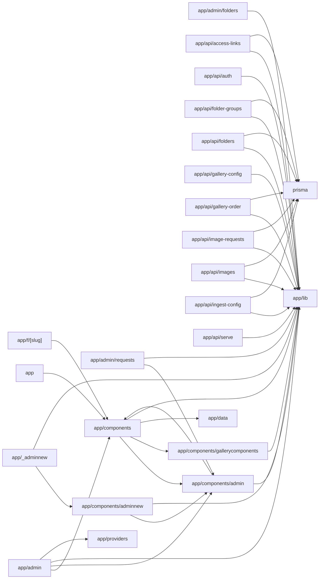

# Dependency / Linking Graph

Static import graph for `app/`, `prisma/`, `scripts/` plus the root config files.
Generated by resolving every `import ... from`, `require(...)` and dynamic
`import(...)` to a real file on disk (`@/` alias included). External packages are
counted separately.

| Metric | Value |
| --- | --- |
| Files scanned | 110 |
| Internal import edges | 175 |
| Circular dependencies (file level) | **0** |
| Highest in-degree module | `app/lib/auth.ts` (29) |

## 1. Layer view

```
Browser
└─ app/page.tsx · app/f/[slug] · app/admin/** · app/_adminnew (parked, not routed)
   └─ app/components/**
      ├─ admin/**            (legacy admin UI)
      ├─ adminnew/**         (new admin UI, WIP)
      └─ gallerycomponents/**
         └─ app/lib/**       (auth, assets, storage, imageData, imageProcessing, viewTracking, hooks)
            └─ prisma/client.ts
               └─ @prisma/adapter-mariadb → MySQL

app/api/**  (route handlers)  →  prisma/client.ts + app/lib/{auth,storage}.ts
scripts/*.js (ingest / tests) →  prisma/client.ts (driver adapter)
```

## 2. Directory graph



## 3. High in-degree hubs

These are the files to treat as API surface. Changing them fans out widely.

| File | Importers | Notes |
| --- | --- | --- |
| `app/lib/auth.ts` | 29 | Auth contract; every guarded page and authenticated route imports it |
| `prisma/client.ts` | 25 | Single DB client; all route handlers depend on it |
| `app/components/admin/types.ts` | 20 | Shared admin types across legacy + new admin |
| `app/lib/storage.ts` | 9 | Storage driver abstraction |
| `app/components/admin/fileUtils.ts` | 5 | |
| `app/components/adminnew/folderMeta.ts` | 5 | |
| `app/components/adminnew/ui.tsx` | 5 | |
| `app/lib/assets.ts` | 5 | |
| `app/components/adminnew/types.ts` | 4 | |
| `app/lib/useUploads.tsx` | 4 | |

## 4. Blast radius

**`prisma/client.ts` (25 direct importers)** — every API route under
`app/api/**`, plus `app/api/images/download-zip/sessionStore.ts` and the
`scripts/*` entry points. A signature change here is a whole-backend change.

**`app/lib/auth.ts` (29 direct importers)** — all guarded pages
(`app/admin/**`, `app/_adminnew`) and every authenticated API route. The
`authOptions` object is the de-facto auth contract; prefer adding options over
restructuring. `app/api/auth/[...nextauth]/route.ts` is now a thin
`NextAuth(authOptions)` adapter and should stay that way.

**`app/components/admin/types.ts` (20 direct importers)** — shared by both the
legacy `admin/**` tree and the new `adminnew/**` tree, so it is the bridge that
keeps the two admin UIs coupled.

**`app/lib/storage.ts` (9 direct importers)** — all file-serving, upload, bulk,
and zip routes. Changing the storage driver contract touches every media route.

## 5. External packages (by import count)

| Package | Imports |
| --- | --- |
| `next` | 56 |
| `react` | 36 |
| `next-auth` | 32 |
| `react-icons` | 19 |
| `node:fs` | 15 |
| `node:path` | 12 |
| `lucide-react` | 10 |
| `@prisma/client` | 7 |
| `node:crypto` | 6 |
| `node:stream` | 5 |
| `dotenv` | 5 |
| `@prisma/adapter-mariadb` | 4 |
| `node:http` | 3 |
| `sharp` | 3 |
| `slugify` | 2 |

## 6. Structural notes

- **No file-level cycles.** The only directory-level loop is
  `app/components ↔ app/components/admin` (`AdminPanel.tsx` imports the admin
  hooks; admin components import shared pieces from `app/components`). It is a
  UI-layer loop only and does not affect the server bundle.
- **`app/_adminnew`** is parked as a Next private folder. It still imports
  `app/lib/auth` and `app/components/adminnew` but is excluded from routing and
  the build until `SettingsSection.tsx` exists.
- **`prisma/client.ts` is the only DB entry point** — keep it that way; adding a
  second `new PrismaClient()` elsewhere would duplicate the driver adapter and
  connection pool.
- **`authOptions` now lives in `app/lib/auth.ts`.** The NextAuth route handler
  only wires `NextAuth(authOptions)`, so importing `authOptions` no longer pulls
  in a route module. Keep new auth imports pointed at `@/app/lib/auth`.

---

Regenerate: the generator script resolves imports statically; re-run it after
large file moves so the in-degree table stays accurate.
